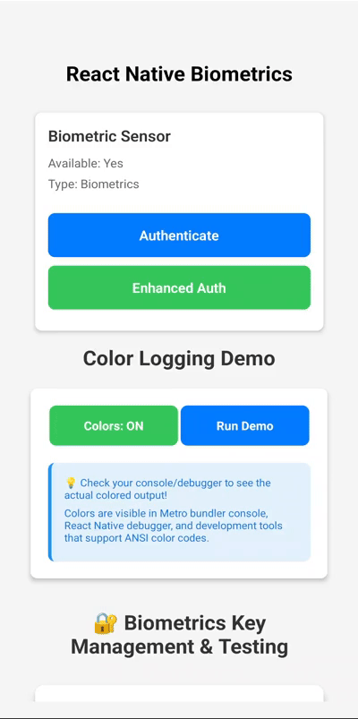

<div align="center">
  <h1>🔐 React Native Biometrics</h1>
  <p><strong>A lightweight and unified React Native library for biometric authentication across iOS and Android</strong></p>

  <p>
    
    
    
    
    
  </p>

  <p>
    
    
    
  </p>

  <p>
    <strong>📖 Documentation: <a href="https://sbaiahmed1.github.io/react-native-biometrics/">sbaiahmed1.github.io/react-native-biometrics</a></strong>
  </p>
</div>

## 🎬 Demo

<div style="display: flex; justify-content: center; gap: 20px;">
  
  
</div>

---

## ✨ Features

- 🔒 **Unified API** for Face ID, Touch ID, Optic ID and Android biometrics
- 🛠️ **Configurable prompts** with fallback to device credentials
- 🔑 **Key management** with EC256 and RSA2048 keys, hardware-backed where the platform supports it
- 🔏 **Non-biometric signing** with Keychain/Keystore keys, without a prompt
- 🛡️ **Device integrity** checks for rooted and jailbroken devices
- 🔔 **Biometric change detection** for enrollment changes
- 🎯 **TypeScript**, a TurboModule for the new architecture, and an Expo config plugin

## 📋 Requirements

| Platform     | Minimum Version |
|--------------|-----------------|
| React Native | 0.81+           |

The library is a TurboModule and requires React Native's [new architecture](https://reactnative.dev/architecture/landing-page). Since version 1.0 the old architecture is not supported; apps still on it can stay on version 0.17.x.

## 🚀 Installation

```bash
npm install @sbaiahmed1/react-native-biometrics
# or
yarn add @sbaiahmed1/react-native-biometrics
```

Then follow the [installation guide](https://sbaiahmed1.github.io/react-native-biometrics/docs/getting-started/installation) for the Expo config plugin or the manual iOS and Android permissions.

## 📖 Usage

```typescript
import {
  isSensorAvailable,
  simplePrompt,
} from '@sbaiahmed1/react-native-biometrics';

async function authenticate(): Promise<boolean> {
  const sensor = await isSensorAvailable();
  if (!sensor.available) {
    console.log('Biometrics not available:', sensor.error);
    return false;
  }

  const result = await simplePrompt('Please authenticate to continue');
  return result.success;
}
```

## 📚 Documentation

The full documentation lives at **[sbaiahmed1.github.io/react-native-biometrics](https://sbaiahmed1.github.io/react-native-biometrics/docs/getting-started/installation)**.

**Getting started**

- [Installation](https://sbaiahmed1.github.io/react-native-biometrics/docs/getting-started/installation)
- [Quick start](https://sbaiahmed1.github.io/react-native-biometrics/docs/getting-started/quick-start)
- [Migrating from react-native-biometrics](https://sbaiahmed1.github.io/react-native-biometrics/docs/getting-started/migration)

**Usage**

- [Authentication](https://sbaiahmed1.github.io/react-native-biometrics/docs/usage/authentication)
- [Key management](https://sbaiahmed1.github.io/react-native-biometrics/docs/usage/key-management)
- [Non-biometric signing](https://sbaiahmed1.github.io/react-native-biometrics/docs/usage/non-biometric-signing)
- [Debugging](https://sbaiahmed1.github.io/react-native-biometrics/docs/usage/debugging)

**API reference**

- [Overview](https://sbaiahmed1.github.io/react-native-biometrics/docs/api)
- [Configuration](https://sbaiahmed1.github.io/react-native-biometrics/docs/api/configuration)
- [Core functions](https://sbaiahmed1.github.io/react-native-biometrics/docs/api/core-functions)
- [Key management](https://sbaiahmed1.github.io/react-native-biometrics/docs/api/key-management)
- [Device security](https://sbaiahmed1.github.io/react-native-biometrics/docs/api/device-security)
- [Debugging](https://sbaiahmed1.github.io/react-native-biometrics/docs/api/debugging)
- [Logging](https://sbaiahmed1.github.io/react-native-biometrics/docs/api/logging)
- [Key integrity](https://sbaiahmed1.github.io/react-native-biometrics/docs/api/key-integrity)
- [Biometric change detection](https://sbaiahmed1.github.io/react-native-biometrics/docs/api/biometric-change-detection)
- [Error codes](https://sbaiahmed1.github.io/react-native-biometrics/docs/api/error-codes)

**Guides**

- [Biometric change detection](https://sbaiahmed1.github.io/react-native-biometrics/docs/guides/biometric-change-detection)
- [Key alias security](https://sbaiahmed1.github.io/react-native-biometrics/docs/guides/key-alias-security)
- [Cryptographic keys](https://sbaiahmed1.github.io/react-native-biometrics/docs/guides/cryptographic-keys)
- [Logging](https://sbaiahmed1.github.io/react-native-biometrics/docs/guides/logging)
- [Security](https://sbaiahmed1.github.io/react-native-biometrics/docs/guides/security)

**More**

- [Example app](https://sbaiahmed1.github.io/react-native-biometrics/docs/example-app)
- [Comparison with other libraries](https://sbaiahmed1.github.io/react-native-biometrics/docs/comparison)
- [Troubleshooting](https://sbaiahmed1.github.io/react-native-biometrics/docs/troubleshooting)
- [Contributing](https://sbaiahmed1.github.io/react-native-biometrics/docs/contributing)
- [Roadmap](https://sbaiahmed1.github.io/react-native-biometrics/docs/roadmap)

## 📄 License

MIT

## 🙏 Acknowledgments

- Built with [create-react-native-library](https://github.com/callstack/react-native-builder-bob)
- Inspired by existing libraries like [react-native-biometrics](https://github.com/SelfLender/react-native-biometrics)

## 📊 Stats

<div align="center">
  
  
  
  
</div>

---

<div align="center">
  <p>Made with ❤️ by <a href="https://github.com/sbaiahmed1">@sbaiahmed1</a></p>
  <p>⭐ Star this repo if it helped you!</p>

  <p>
    <a href="https://github.com/sbaiahmed1/react-native-biometrics/issues">Report Bug</a> ·
    <a href="https://github.com/sbaiahmed1/react-native-biometrics/issues">Request Feature</a> ·
    <a href="https://github.com/sbaiahmed1/react-native-biometrics/discussions">Discussions</a>
  </p>
</div>
